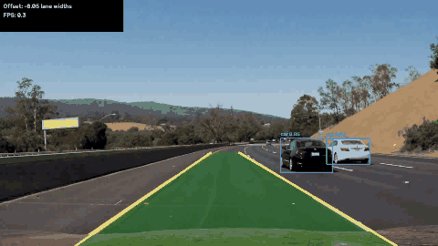
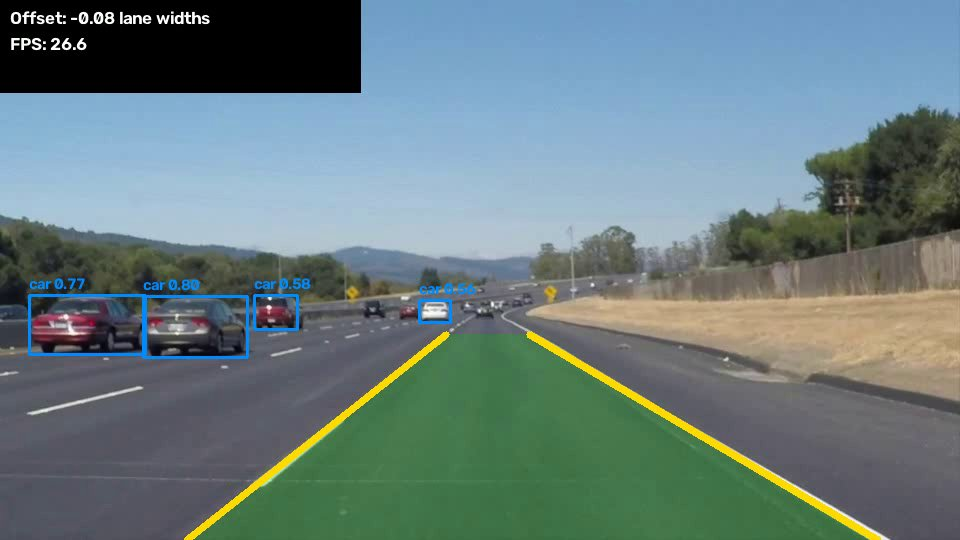

# ADAS Perception Pipeline

Camera-based perception for driver assistance: **lane detection**, **road object detection** and two simple
warning functions — **Lane Departure Warning (LDW)** and **Forward Collision Warning (FCW)**.



## What it does

| Module | Method | File |
|---|---|---|
| Lane detection | HLS color mask (white/yellow) → Gaussian blur → Canny → trapezoid ROI → probabilistic Hough transform → weighted least-squares line fit → exponential smoothing between frames | `adas/lanes.py` |
| Object detection | Pretrained YOLO11n (COCO), filtered to road classes: car, truck, bus, person, bicycle, motorcycle, traffic light, stop sign | `adas/objects.py` |
| Lane departure warning | Offset of the camera from the ego-lane center, in lane widths; warning when \|offset\| > 0.25 | `adas/alerts.py` |
| Forward collision warning | Object whose bottom-center lies inside the ego-lane polygon and whose box height is > 18% of the frame (larger box ≈ closer object, pinhole model) | `adas/alerts.py` |

Some design choices:
- Lines are fitted as `x = k·y + b` instead of `y = k·x + b`, because lane lines are close to vertical in the image.
- Hough segments are split into left/right by slope sign and image half, and near-horizontal segments are dropped.
- If a line is not found in a frame, the last estimate is kept for up to 10 frames, so short gaps (dashed lines, shadows) do not break the output.

## Results

Tested on the three Udacity test videos (960×540 and 1280×720, 25 fps), CPU only (Intel Core i5-11320H):

| Video | Frames | Frames with both lanes | Lane detection, ms/frame | YOLO11n, ms/frame |
|---|---|---|---|---|
| solidWhiteRight | 221 | 100% | 6.7 | 57.9 |
| solidYellowLeft | 681 | 100% | 7.0 | 44.1 |
| challenge (shadows, light concrete) | 251 | 100% | 11.9 | 50.5 |

The full pipeline runs at ~18–26 FPS on a laptop CPU.
"Frames with both lanes" counts frames with an output; correctness was checked visually, not against labeled ground truth.



## Limitations

- Straight-line lane model: sharp curves are approximated poorly (a 2nd-order polynomial on a bird's-eye view would fix this).
- Fixed ROI and color thresholds tuned for daytime highway video; night, rain and missing markings are not handled.
- FCW uses box height as a distance proxy; no camera calibration or real distance estimation.
- No quantitative lane accuracy yet (next step: evaluate on the TuSimple benchmark).

## Run

```bash
python -m venv .venv
.venv\Scripts\activate            # Linux: source .venv/bin/activate
pip install -r requirements.txt
python run.py --input data/solidWhiteRight.mp4 --output output/solidWhiteRight.mp4
python run.py --input data/challenge.mp4 --output output/challenge.mp4 --no-objects   # lanes only
pytest -q
```

YOLO weights (`yolo11n.pt`) are downloaded automatically by Ultralytics on the first run.
Statistics for each run are saved next to the output video as `.json`.

## Project structure

```
adas/
  lanes.py      lane detection
  objects.py    YOLO wrapper
  alerts.py     LDW / FCW logic
  draw.py       visualization
run.py          video pipeline + timing statistics
tests/          unit tests on synthetic images
data/           test videos
```

## Credits

- Test videos: [udacity/CarND-LaneLines-P1](https://github.com/udacity/CarND-LaneLines-P1) (MIT License).
- Object detection: [Ultralytics YOLO](https://github.com/ultralytics/ultralytics) (AGPL-3.0); this project is therefore also released under AGPL-3.0.
